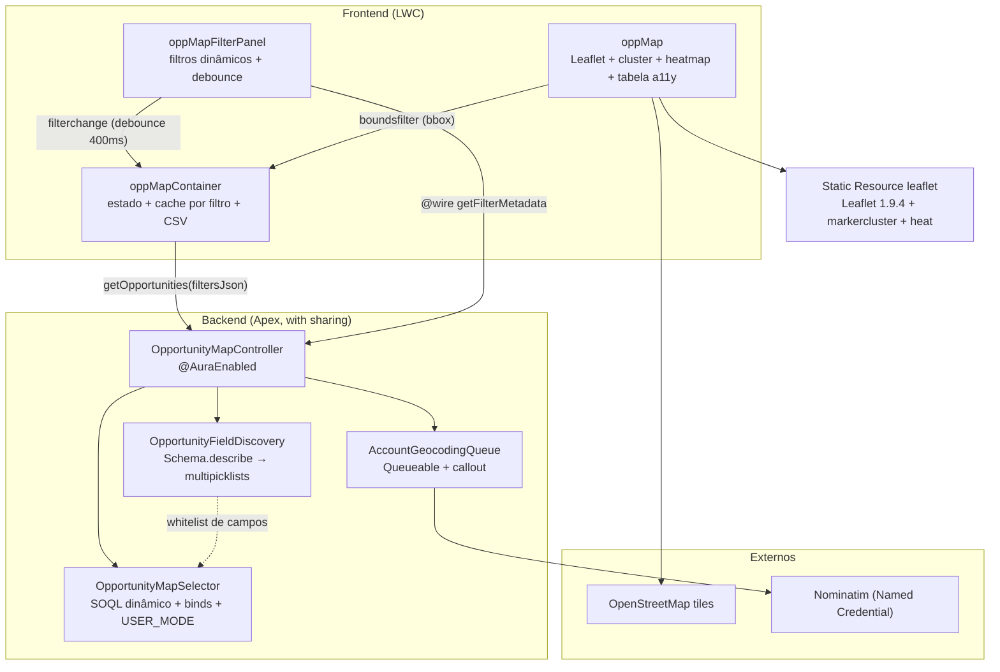

# Opportunity Map — Mapa de Oportunidades com Filtros Dinâmicos

Componente Lightning Web Component que renderiza um mapa mundial interativo com Oportunidades geolocalizadas e um painel de filtros **construído dinamicamente** — qualquer campo multipicklist customizado da Opportunity (ex.: `Tag__c`, `Etiqueta__c`) vira um filtro automaticamente, sem uma linha de código a mais.

## O problema de negócio

Gestores comerciais precisam enxergar a distribuição geográfica do pipeline — onde estão as oportunidades, quais regiões concentram vitórias, quais territórios estão descobertos — e filtrar essa visão pelas dimensões que **cada org** define (tags, segmentos, produtos). Componentes de mapa tradicionais quebram quando a org adiciona um campo novo; este descobre os campos em runtime via `Schema.describe`.

## Arquitetura



## Segurança do SOQL dinâmico

O núcleo do projeto é montar SOQL dinamicamente **sem abrir brecha de injection**:

1. **Valores** entram sempre por bind variables (`Database.queryWithBinds`).
2. **Nomes de campo** vindos do cliente só entram na query se existirem na whitelist gerada por `Schema.describe` (apenas multipicklists reais da Opportunity) — nome desconhecido lança exceção (há teste cobrindo tentativa de injection).
3. Literais de `INCLUDES` (que não aceita bind) passam por `String.escapeSingleQuotes`.
4. A query final roda `WITH USER_MODE` — CRUD/FLS do usuário respeitados de ponta a ponta.

## Filtros suportados

| Categoria | Filtros |
|---|---|
| Temporal | Range de `CloseDate`; idade do ciclo (`CloseDate − CreatedDate`, pós-query) |
| Estrutural | Record Type, faixa de `Amount`, estágios, ganhas/perdidas/abertas |
| Produto | Multi-select de produtos via `OpportunityLineItem → Product2` |
| Dinâmico | Qualquer multipicklist descoberto, com modos "contém qualquer" e "contém todos" |
| Geográfico | Bounding box da área visível do mapa (botão "Filtrar pela área visível") |

## Trade-off: Leaflet vs Google Maps

**Escolhido: Leaflet.js** (via Static Resource).

| | Leaflet | Google Maps |
|---|---|---|
| Custo / API key | Grátis, sem chave | Exige chave + billing |
| Empacotamento | Static Resource offline, sem domínio externo de JS (CSP amigável) | Script externo (Trusted Site + risco de bloqueio CSP) |
| Plugins | markercluster e heatmap open source | Nativos, porém atrelados ao billing |
| Qualidade de tiles/geocoding | OpenStreetMap (bom, comunidade) | Superior em POIs e geocoding |

**Para trocar por Google Maps**: substitua o carregamento em `oppMap.js` (`loadScript` do resource) pelo script `maps.googleapis.com` (registre CSP Trusted Site), troque `L.map/L.marker` por `google.maps.Map/AdvancedMarkerElement` e use `MarkerClusterer` do `@googlemaps/markerclusterer`. O restante (painel, controller, selector) não muda — o contrato é só a lista de markers.

## Geocodificação assíncrona

Contas sem `BillingLatitude/Longitude` são geocodificadas em background (`Queueable` + callout ao Nominatim via Named Credential `Nominatim`), com **cache de 90 dias** em `Geocode_Cache_Timestamp__c` — inclusive para endereços que falharam, evitando repetir chamadas. Máximo de 20 callouts por execução, com encadeamento automático do restante.

## Instalação em Scratch Org

```bash
sf org login web --alias devhub --set-default-dev-hub
sf org create scratch --definition-file config/project-scratch-def.json --alias map-scratch --set-default
sf project deploy start
sf org assign permset --name Opp_Map_User
sf apex run --file scripts/apex/setup-map-demo.apex   # contas em 3 continentes + opps com Tag__c
```

Depois, adicione o componente **Opportunity Map Container** a uma App Page no Lightning App Builder.

> Em org Developer Edition: pule a criação da scratch e use `-o sua-org` nos comandos.

## Testes

- **Apex** (19 testes, 100%): construção do SOQL com todas as combinações de filtro, whitelist anti-injection, descoberta de multipicklist, geocoding com `HttpCalloutMock` (sucesso, vazio, erro HTTP, cache).
- **Jest** (6 testes): renderização condicional dos filtros dinâmicos a partir do wire mockado, debounce + payload do `filterchange`, cache client-side por combinação de filtro, estados de erro.

```bash
npm install --legacy-peer-deps
npm run test:unit
sf apex run test --tests OpportunityMapSelectorTest --tests OppMapControllerAndDiscoveryTest --tests AccountGeocodingQueueTest --code-coverage --wait 20
```

## Performance

- Limite de 10.000 marcadores por consulta (com aviso "refine seus filtros" + flag `truncated`); clustering com `chunkedLoading` no Leaflet para não travar o navegador ao inserir milhares de marcadores de uma vez. Testado com ~1.700 oportunidades geolocalizadas via carga em massa (Bulk API): consulta única, 70-200ms.
- Cache client-side por combinação de filtros na sessão (repetir um filtro não refaz a query).
- Clustering de marcadores (Leaflet.markercluster) para alta densidade.
- Debounce de 400 ms no painel — nada de query por clique.

## Demonstração

> _Placeholder: adicionar GIF do mapa com clustering, heatmap e filtros dinâmicos._

## Licença

MIT — Leaflet (BSD-2), Leaflet.markercluster (MIT), leaflet-heat (MIT), tiles © OpenStreetMap contributors.
