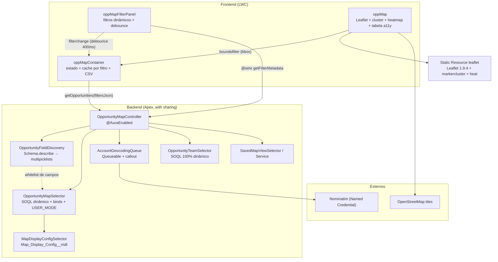

# Opportunity Map

Mapa interativo de oportunidades em Lightning Web Components, com painel de filtros montado em runtime: qualquer campo multipicklist da Opportunity vira filtro sem alterar código.

[](https://github.com/witorlomazzi/opp-map/actions/workflows/ci.yml)

> Projeto demonstrativo, com empresa e dados fictícios. Experiências profissionais reais não são publicadas por confidencialidade.

**Estudo de caso:** [salesforce.flupdigital.com.br/projetos/opportunity-map.html](https://salesforce.flupdigital.com.br/projetos/opportunity-map.html) · **Demo no navegador:** [abrir a demo](https://salesforce.flupdigital.com.br/projetos/opportunity-map.html#demo)

## O problema

Gestores comerciais precisam ver onde o pipeline está concentrado, quais regiões convertem e quais territórios estão descobertos. Uma lista não mostra isso. E componentes de mapa com filtros fixos quebram quando a org cria um campo novo de segmentação.

## A solução

- Mapa com clustering, heatmap de oportunidades ganhas e tabela acessível como alternativa ao mapa.
- Filtros descobertos em runtime via `Schema.describe`: tags, segmentos e qualquer multipicklist da Opportunity.
- Painel da conta com proprietário, idade da oportunidade, link para o registro e equipe carregada sob demanda.
- Visões salvas: o usuário guarda uma combinação de filtros e reaplica com um clique.
- Geocodificação assíncrona das contas sem coordenadas, com cache.

## Arquitetura



## Decisões técnicas

| Decisão                                          | Por quê                                                                           | Custo da escolha                                                |
| ------------------------------------------------ | --------------------------------------------------------------------------------- | --------------------------------------------------------------- |
| Leaflet em Static Resource, e não Google Maps    | Sem chave de API nem billing, e sem script externo (compatível com CSP)           | Geocoding e pontos de interesse menos precisos que os do Google |
| Filtros descobertos por `Schema.describe`        | A org cria um campo novo e ele aparece como filtro, sem deploy                    | Exige whitelist rígida para o SOQL dinâmico continuar seguro    |
| Geocodificação em `Queueable`                    | Callout fora da transação do usuário, com encadeamento de lotes                   | O mapa mostra a conta só depois do processamento                |
| `OpportunityTeamSelector` com SOQL 100% dinâmico | Opportunity Teams pode estar desligado; referenciar o tipo quebraria a compilação | Perde a checagem de tipo em tempo de compilação                 |
| Limiares de idade em `Map_Display_Config__mdt`   | O admin ajusta sem tocar em Apex                                                  | Mais um registro de configuração para manter                    |

Para trocar por Google Maps, substitua o carregamento em `oppMap.js` pelo script `maps.googleapis.com` (registrando o Trusted Site no CSP) e troque `L.map`/`L.marker` por `google.maps.Map`/`AdvancedMarkerElement`. Painel, controller e selector não mudam: o contrato é só a lista de marcadores.

## Segurança

O núcleo do projeto é montar SOQL dinâmico sem abrir brecha para injeção:

1. **Valores** entram sempre por bind (`Database.queryWithBinds`).
2. **Nomes de campo** vindos do cliente só entram na query se estiverem na whitelist gerada por `Schema.describe`. Nome desconhecido lança exceção, e há teste cobrindo a tentativa de injeção.
3. Literais de `INCLUDES`, que não aceita bind, passam por `String.escapeSingleQuotes`.
4. A query roda `WITH USER_MODE`: CRUD, FLS e sharing do usuário valem de ponta a ponta.

## Desempenho

- Limite de 10.000 marcadores por consulta, com aviso para refinar os filtros e flag `truncated`.
- `chunkedLoading` no clustering, para não travar o navegador com milhares de marcadores.
- Cache no cliente por combinação de filtros e debounce de 400 ms no painel.
- Medição feita com cerca de 1.700 oportunidades geolocalizadas carregadas via Bulk API: consulta única entre 70 e 200 ms. O script está em `scripts/apex/perf-test-selector.apex`.

## Testes

- **Apex:** 29 métodos de teste. Cobrem a montagem do SOQL com todas as combinações de filtro, a whitelist contra injeção, a descoberta de multipicklists, o geocoding com `HttpCalloutMock` (sucesso, vazio, erro HTTP e cache), a cor por idade, a equipe da oportunidade com e sem Opportunity Teams e as visões salvas.
- **Jest:** 6 testes. Cobrem filtros dinâmicos a partir do wire mockado, debounce e payload do `filterchange`, cache por combinação de filtros e estados de erro.
- **CI:** o GitHub Actions roda o Jest e o Salesforce Code Analyzer (PMD) em cada push e pull request. O deploy de validação com testes Apex roda quando o repositório tem uma org de CI configurada.

```bash
npm install --legacy-peer-deps
npm run test:unit
sf apex run test --test-level RunLocalTests --code-coverage --wait 20
```

## Como rodar

```bash
sf org login web --alias devhub --set-default-dev-hub
sf org create scratch --definition-file config/project-scratch-def.json --alias map-scratch --set-default
sf project deploy start
sf org assign permset --name Opp_Map_User
sf apex run --file scripts/apex/setup-map-demo.apex   # contas em 3 continentes e oportunidades com Tag__c
```

Depois, adicione o componente **Opportunity Map Container** a uma App Page no Lightning App Builder. Em uma Developer Edition, pule a criação da scratch org e use `-o <sua-org>` nos comandos.

## Por onde começar a ler o código

| Arquivo                                                        | O que observar                                              |
| -------------------------------------------------------------- | ----------------------------------------------------------- |
| `force-app/main/default/classes/OpportunityMapSelector.cls`    | Montagem do SOQL dinâmico com bind, whitelist e `USER_MODE` |
| `force-app/main/default/classes/OpportunityFieldDiscovery.cls` | Descoberta de multipicklists via `Schema.describe`          |
| `force-app/main/default/classes/AccountGeocodingQueue.cls`     | Callout em `Queueable`, cache de 90 dias e encadeamento     |
| `force-app/main/default/classes/OpportunityTeamSelector.cls`   | Degradação segura quando Opportunity Teams está desligado   |
| `force-app/main/default/lwc/oppMapContainer/`                  | Estado, cache por filtro e exportação CSV                   |

## Limitações e próximos passos

- Geocodificação limitada a 20 callouts por execução. Carteiras grandes levam várias execuções encadeadas até ficarem completas no mapa.
- Os tiles e o geocoding dependem de serviços públicos do OpenStreetMap, sem SLA.

## Licença

MIT. Leaflet (BSD-2), Leaflet.markercluster (MIT), leaflet-heat (MIT), tiles © OpenStreetMap contributors.
